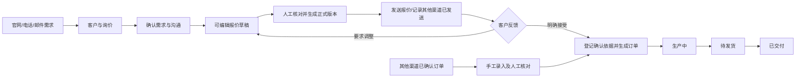

# VERA 全系统流程与 AI 优化方案

日期：2026-10-15｜阶段：调研与设计决策，尚未实施本方案

## 1. 结论

当前问题不是按钮不够漂亮，而是业务对象、编辑状态、沟通记录和 AI 入口没有统一。应先明确每个动作改变什么记录、何时需要人工确认，再确定页面布局。

建议：报价编辑改为同页三个分区，保留业务结构，取消强制逐步翻页；询价、报价、订单共用沟通时间线；AI 嵌入文本编辑与资料提取，不另建一排助手按钮。正式报价版本、订单确认和邮件发送仍是明确的人工动作。

## 2. 已核对的问题与证据边界

检查了 CrmView、QuoteSteps、InquiryEmail、ManualOrderForm、ProductManager、官网询价及页脚；同时检查后端报价、订单、邮件、跟进、助手接口。PR4 已合并。

| 问题 | 已确认的代码事实 | 后果 |
|---|---|---|
| 第二步像“走不通” | 询价预填不填材质、颜色、控制方式、单价；下一步校验这些字段，却只返回一条总提示 | 用户不知道具体要补什么；已有产品信息也没有被合理复用 |
| 步骤与最终校验不一致 | 单价12.345能通过 stepError 到第三步，但输入设置 step=0.01 | 最后提交可能被原生表单校验阻止；错误字段此时在 v-show 隐藏区 |
| 多套校验重叠 | 原生 required/min/step、步骤函数和后端分别校验 | 看似进入下一步，并不代表能够保存；错误缺少字段定位 |
| 无可持久保存的不完整草稿 | “创建报价”只是前端编辑态，后端保存要求完整明细并立即产生不可覆盖版本 | 草稿、正式报价、修订版本混在一起；切菜单可能丢编辑状态 |
| 邮件与内部记录混淆 | InquiryEmail只挂在询价页；“本次沟通”保存followups；成功发送又把邮件拼成followups.note | 两个输入区域没有解释对内/对外区别；缺少明确活动类型 |
| 发邮件不等于发报价 | 邮件接口没有绑定报价版本，也不附报价文件 | 不能确定客户收到哪个版本；报价已发送状态缺失 |
| 不是实际AI | 助手为确定性规则，返回未连接模型；同一路径POST助手注册了两次 | 新旧协议不同，路由可能使用先注册实现；不应宣传为真实AI |
| 导航重复 | 每页都有侧栏、四个统计卡、全局询价→报价→订单导航 | 两套菜单重复；手工订单并不经过这条路径 |
| 客户联系方式不结构化 | 电话、邮箱、微信拼接进channel；邮件收件人再用正则提取 | 无可靠联系人/收件地址选择；重复录入和误发风险增加 |
| 邮件能力还不闭环 | SMTP只负责发送，没有收件同步、独立消息状态或发送队列 | 邮件服务器接受不代表送达；回复不会自动回到系统 |

代码级复现：预填询价明细停在第2步；补齐明细后到第3步；单价12.345也能到第3步。未执行浏览器点击复现，因此不能断言已经定位用户此次卡住的唯一原因。后续必须补实际界面验收。

## 3. 调研依据与设计取舍

- [HubSpot：创建/记录活动](https://knowledge.hubspot.com/records/manually-log-activities-on-records)：邮件、电话、备注、任务各有明确类型，但关联到业务记录的时间线。对本系统的取舍是共用时间线，不共用一个含义模糊的文本框。
- [Odoo：创建报价](https://www.odoo.com/documentation/18.0/applications/sales/sales/sales_quotations/create_quotations.html)：编制报价、发给客户、客户确认后成为订单。对本系统的取舍是补齐“正式版本”和“已发送”，不把保存等同于客户确认。
- [NN/g：向导设计](https://www.nngroup.com/articles/wizards/)：向导适合低频或新手的复杂过程。本系统销售会反复录入和修订报价，因此建议同页编辑、分区定位，减少来回跳转。这是针对VERA的设计判断，并非来源要求所有报价都取消向导。
- [MDN：表单约束校验](https://developer.mozilla.org/en-US/docs/Web/HTML/Guides/Constraint_validation)：required、min、step都参与提交校验。对本系统的取舍是统一业务校验规则，并将错误显示到具体字段，避免隐藏区的错误阻止提交。
- frontend-design skill：采用简洁业务单据风格，强调信息层级、间距和上下文操作；不增加装饰性大卡片或为了体现AI而增加按钮。

## 4. 整体业务流程

客户是关系档案；询价是一个项目需求；报价是商业方案及版本；订单是已确认的执行记录。同一客户可以有多个询价，不能把客户本身当作一个销售阶段。

## 5. 每个菜单的职责

| 菜单 | 用户来这里完成什么 | 主操作 | 清理/合并 |
|---|---|---|---|
| 工作台 | 看今天要处理的真实事项 | 打开待办、处理逾期跟进 | 统计集中于此；没有业务意义的计数不占每个详情页 |
| 客户 | 查联系人、联系方式、语言及关联项目 | 新增/编辑客户、进入相关项目 | 客户资料只维护一次；多联系人可选择，不固定取第一人 |
| 询价 | 理解需求、补齐信息、决定是否报价 | 创建/继续报价草稿、联系客户 | 不复制报价编辑；沟通区域统一，不保留平铺的五个助手按钮 |
| 报价 | 编制、修订、发出和确认商业方案 | 保存草稿、核对版本、发送报价、登记接受 | 保存/发送/确认分开；历史版本只读；只提供当前状态适用的动作 |
| 订单 | 接收已确认订单并跟进履约 | 手工录入、更新执行阶段、联系客户 | 报价来源自动关联；手工来源不伪造询价/报价；来源展示清楚 |
| 产品 | 维护供选型和官网展示的目录 | 保存产品、管理图片、发布/隐藏 | 报价和录单选用同一目录，不再重新填写已有固定材质和选项 |
| 设置 | 管理账号、邮件、AI、公司资料 | 测试连接、保存配置、管理权限 | 用户权限移入设置；SMTP和AI只对管理员配置；密钥不返回前端 |

工作台是新增的任务入口，不是再复制一套菜单。全局“询价→报价→订单”按钮移除，改为具体项目内的进度与关联记录。账号、语言、退出统一在一处。

官网保持首页、产品、关于、获取报价四项：了解公司→看产品/图库→提交需求。页脚可以链接同一询价入口，不另建重复联系表单；示例联系方式/未配置社交链接不做假按钮。

## 6. 报价编辑的具体决定

建议取消强制三页向导，改成一个编辑页的三个分区：

1. 客户与报价条件：客户/联系人、报价语言、币种、有效期。
2. 产品明细：产品、尺寸/单位、选项、数量、人工单价。
3. 金额与条款：折扣、运费、税额、总额、商务条款。

右侧或底部始终显示金额摘要和“保存草稿”；“核对并生成正式版本”单独出现。草稿允许尺寸/单价暂缺；正式版本才必须满足可对外报价的完整性。错误逐字段显示，顶部错误清单可定位；金额计算统一为确定性Decimal规则。

选择产品后带入已有材质与可选颜色/控制方式；存在多个选项时让销售选择，不猜一个。历史报价内容从快照加载；产品目录修改不能覆盖旧报价/订单。

创建修订时保留原版本，打开一个可编辑草稿，突出变更字段及金额差异。保存草稿不反复增加正式版本；生成新正式版本时旧版本标明已被替代。客户接受必须绑定具体版本、联系人、时间、依据。

如必须保留三步视觉，只将其作为分区导航，不再以缺项阻止浏览或保存草稿。

## 7. “发送邮件”和“本次沟通”的关系

当前：发送邮件会真正尝试向客户发送；本次沟通只是内部备注，不会发送。发送成功的正文又被拼到同一个跟进表中。这种底层复用不应该让用户误以为两个文本框都用于回复客户。

建议改成一个“沟通与跟进”区域，三个明确模式：

| 模式 | 输入 | 提交动作 | 结果 |
|---|---|---|---|
| 邮件 | 收件联系人、主题、正文、关联报价版本/文件 | 发送邮件 | 对外发送；自动进入邮件时间线，无需再手写一遍本次沟通 |
| 记录沟通 | 电话/微信/会议/内部备注、发生时间、记录内容 | 保存记录 | 仅内部留档；不触发发送 |
| 跟进任务 | 跟进事项、负责人、计划时间 | 创建跟进任务 | 出现在待办；不是一条“已完成沟通” |

邮件编辑器里提供“AI生成正文”和“润色/翻译”，生成后仍在正文中供编辑。写记录时提供“AI整理记录”；不再让用户先生成回复、复制、粘贴到邮件、另存跟进。

报价页主操作是“发送这份报价”，自动绑定版本并附正式报价文件；询价页是“联系客户/确认需求”；订单页是“发送进度说明”。三者复用同一编辑器，但有不同业务上下文。

邮件需要独立状态：草稿、待发送、邮件服务器接受、失败、结果不明。只有获得相应证据才标已送达；SMTP本身不提供收件同步。客户回复可先人工记录，后续接入收件服务时再自动归档，不把未实现功能假装存在。

## 8. 输入字段的用途与来源

| 字段组 | 谁输入/来源 | 何时必填 | 避免重复的规则 |
|---|---|---|---|
| 客户名称、联系人 | 客户档案或新增客户表单 | 建立可联系的业务记录时 | 询价/报价/订单都引用同一客户；新增前提示匹配候选，不自动合并 |
| 邮箱、电话、微信 | 分类型联系方式 | 至少一种联系方式；发邮件必须有确认的邮箱 | 不再拼为channel再正则拆分；联系人明确选择 |
| 客户沟通语言 | 客户偏好，可在具体邮件/报价覆盖 | 发出文档时 | 与界面语言分离；不能切中文UI就擅自改英文客户邮件 |
| 产品与材质/选项 | 产品目录与项目选型 | 生成正式报价/确认订单时 | 固定材质自动带入；选项选择；历史使用快照 |
| 尺寸、单位、数量 | 原始询价/沟通/销售确认 | 正式报价和确认订单时；草稿可缺 | 明确每一行、单位、未确定状态；AI提取值先确认再应用 |
| 单价、折扣、税额、运费 | 人工确认的商业条件 | 正式报价/订单时 | AI可提取已知价格但不定价；总额由程序算，不由模型算 |
| 有效期 | 报价默认值，可修改 | 生成/发送正式报价时 | 只属报价；手工订单不展示报价有效期 |
| 条款 | 已批准模板，可编辑 | 正式报价时按业务约定 | AI润色不能引入未经确认的交付/保修/付款承诺 |
| 来源、外部订单号 | 手工录单者 | 来源必填，外部号可选 | 报价转单自动填来源；不要求手工重复填已知数据 |
| 客户确认依据 | 明确的客户反馈或已确认订单资料 | 创建订单时 | 自动带入已有相关邮件，人工确认版本/范围；不把AI判断当接受 |
| 内部备注、电话记录 | 员工录入，可AI整理 | 保存对应记录时 | 不复制成功发送的邮件；内部信息不默认进入对外正文 |
| 下次跟进 | 员工或AI建议 | 创建任务时 | 与保存历史记录分开；AI建议不是已约定时间 |
| 双语产品文案 | 产品管理员；可AI翻译/起草 | 发布时按需要 | 只依据已填真实规格；生成后审阅，不能捏造参数或售后承诺 |

## 9. 按钮与状态契约

| 按钮 | 显示/启用条件 | 改变什么 | 不应该发生什么 |
|---|---|---|---|
| 创建/继续报价 | 有客户询价；已存在草稿则显示继续 | 打开对应草稿 | 每点一次不创建重复报价 |
| 保存草稿 | 编辑中，允许缺项 | 持久保存编辑数据 | 不发送、不成单、不产生新正式版本 |
| 核对并生成版本 | 必填完整、价格人工确认 | 冻结正式规格/金额版本 | 不等于已发送或客户接受 |
| 发送报价/邮件 | 有可用发件服务、正确收件人、正文/版本准备好 | 创建可追踪发送任务与消息 | 不重复保存内部沟通；不自动成单 |
| 修订报价 | 有可修订的正式版本 | 创建/继续修订草稿 | 不覆盖旧版本，不另造一个无关联报价 |
| 登记客户接受 | 具体当前版本未失效、确认依据齐全 | 生成一个来源清晰的订单 | 旧版不误接受；重试不生成多单 |
| 手工录入订单 | 有外部已确认业务 | 经核对后建立独立订单 | 不伪造报价/询价；未确认信息不直接当执行指令 |
| 更新订单阶段 | 有订单且本次执行信息明确 | 追加履历并更新阶段 | 不能把AI建议或邮件发出当作已生产/已交付 |
| AI生成/整理 | 对应编辑区有上下文且实际模型已配置 | 只生成候选文本/字段 | 不自动发送、保存订单或改变金额/状态 |
| 保存沟通记录 | 有内容和沟通类型 | 增加内部活动 | 不向客户发送 |
| 创建跟进任务 | 有事项、计划、负责人 | 增加待办 | 不伪造已发生沟通 |
| 保存/发布产品 | 管理员、资料合规 | 修改目录/官网可见性 | 不改变历史快照 |
| 返回/取消 | 编辑中 | 保留草稿或提示未保存内容 | 不无声丢失输入 |

搜索、筛选、分页、查看相关记录、语言切换属于查询/展示操作；不应改变业务状态。无相应能力的动作隐藏或说明不可用原因，不做点了无结果的按钮。

## 10. AI 的优先落点

| 优先级 | 用途 | 输入上下文 | 输出与人工动作 |
|---|---|---|---|
| 1 | 邮件正文/跟进回复 | 选定客户、沟通目的、已确认需求、当前正式报价/订单事实 | 可编辑正文；销售确认后发送 |
| 1 | 需求与订单资料提取 | 员工粘贴的客户邮件/电话笔记/已确认资料 | 产品候选、尺寸/单位/数量/已知价格、来源片段、缺项；人工选择应用 |
| 1 | 沟通整理与下一步 | 本次原文、项目已有记录 | 内部摘要、缺项、建议动作/时间；人工保存或建任务 |
| 2 | 报价修订差异说明 | 两份正式版本/当前草稿差异 | 改动说明邮件；数字来自程序差异，不由AI推算 |
| 2 | 双语产品文案 | 已填写的规格/选项/现有文案 | 翻译与描述；管理员审阅再发布 |
| 2 | 订单进度说明 | 实际阶段与已经确认的交付安排 | 邮件草稿；不能编造交付日期 |

实际接入模型需服务端模型配置、只读上下文、结构化返回、字段校验、超时/失败提示和人工应用。模型未配置时明确显示“模板草稿”或不可用，不把规则模板标AI。

对外邮件使用经过筛选的客户可见事实；不默认把内部谈判备注、成本、利润、密码或密钥放进生成上下文。未知事实返回缺项，不自行补齐。AI按具体任务出现，不新增独立“AI菜单”。

## 11. 数据与实现顺序

1. **先统一流程及草稿**：明确客户/询价/报价/订单关联；统一字段校验；同页编辑；持久草稿、正式版本、草稿恢复和错误定位。合并重复导航与账户入口。
2. **再统一沟通并优先接入文本AI**：结构化联系人；活动、任务、邮件分类型；共享时间线/编辑器；发送队列、重复保护、失败/不明状态；报价附件绑定版本。AI正文与整理直接嵌入编辑器。
3. **最后补其他AI及设置体验**：资料提取/版本差异/双语文案；管理员邮件和模型设置及连接测试；实际收件同步作为独立后续能力。

报价与手工订单应共用产品明细/金额编辑组件；询价、报价、订单应共用通讯组件；旧跟进记录要迁移分类或明确标为历史记录。不能只改前端按钮而让底层状态保持混乱。

## 12. 上线前验收

- 从尺寸未确定的询价保存草稿、离开再回来不丢失；没有错误却无法提交的情况。
- 缺单价定位到对应行；三位小数明确处理；非法尺寸/币种/过期条件与后端规则一致。
- 修订只改需要改的字段；可见旧新差异；历史版本/已确认订单不变。
- 点击发送必须对应正确联系人和报价版本；邮件失败或结果不明不标已送达/已接受；重试不重复发送。
- 发邮件自动归档；内部电话记录不发送；跟进时间创建真实待办；客户回复未接收同步时如实标注。
- 手工订单只创建一单，可关联已有客户；人工核对完成后进入正常状态流。
- AI生成内容直接进编辑区；不重复复制粘贴；未知规格/承诺不臆造；拒绝或失败时原稿仍在。
- 所有按钮有明确反馈；禁用有理由；取消/切菜单不无声丢稿。
- 中文/英文界面与客户沟通语言分别测试；手机/桌面完整走一遍真实操作，而不只运行构建。

本轮只调研、复现代码级问题并形成方案；未改应用代码、未发送邮件、未改变业务数据库，未启动新的重构。
